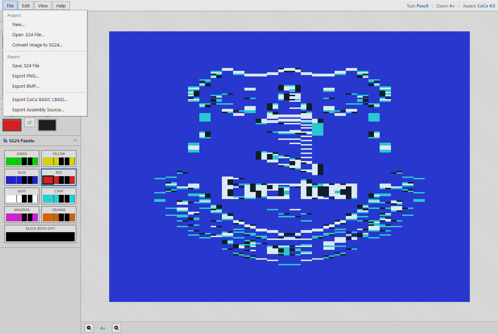
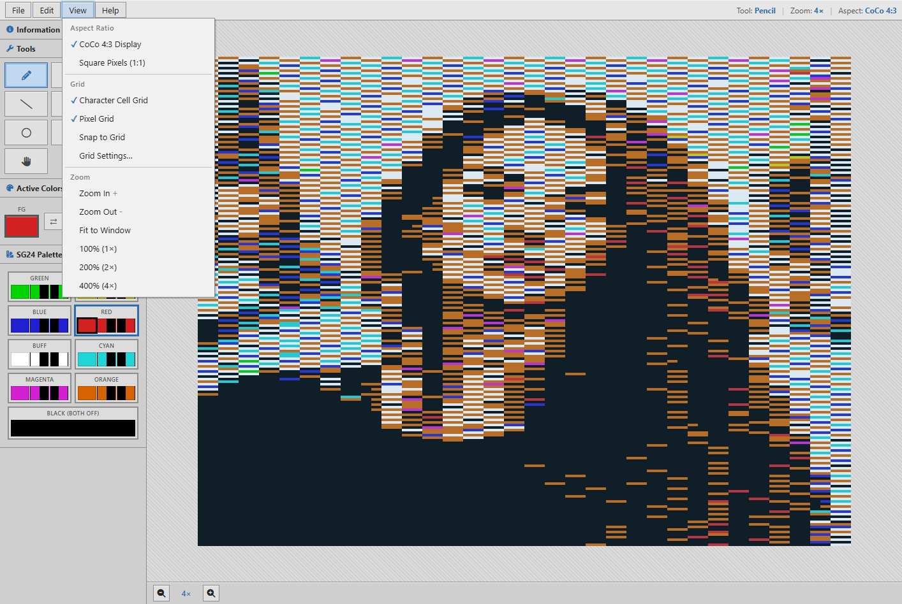
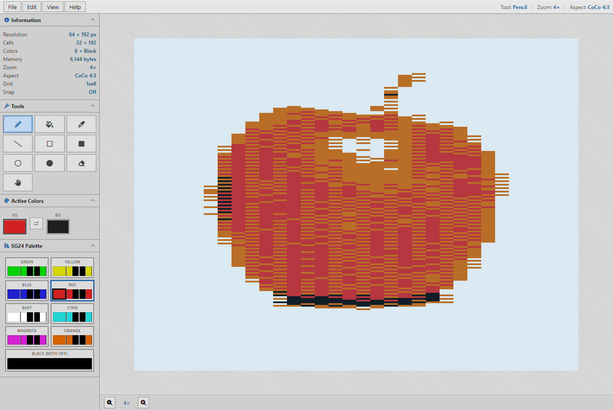
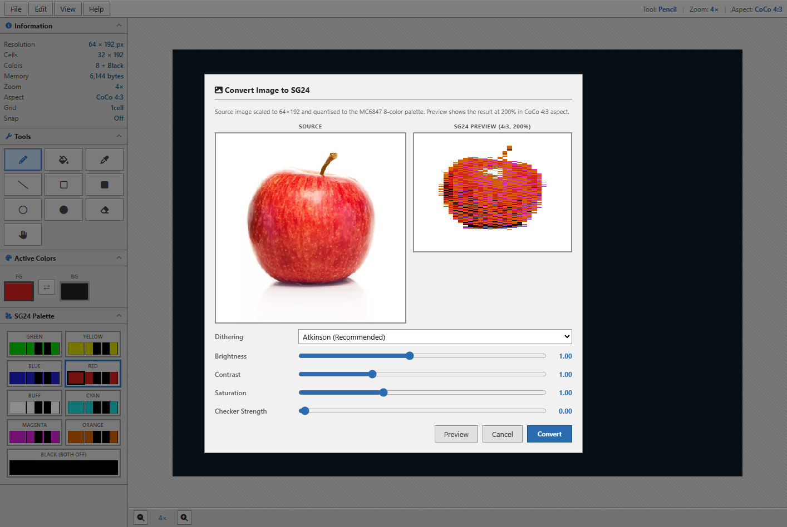

# SemiPaint24

A browser-based image editor for the **TRS-80 Color Computer (CoCo)** Semigraphics 24 (SG24) display mode, running entirely in a single HTML file with no installation required.

## Screenshots

| | |
|---|---|
|  |  |
| *File menu — open, convert, and export options* | *View menu — aspect ratio, grid, and zoom controls* |
|  |  |
| *Freehand drawing with the pencil tool (pumpkin)* | *Convert Image modal with live SG24 preview* |

---

## What Is SG24?

Semigraphics 24 is a video mode for the **Motorola MC6847 Video Display Generator (VDG)** chip used in the TRS-80 Color Computer 1, 2, and 3. It is activated by placing the VDG in alphanumeric mode while setting the **MC6883 SAM** chip to its extended semigraphics addressing mode.

| Property | Value |
|---|---|
| Pixel resolution | 64 × 192 |
| Cell grid | 32 columns × 192 rows |
| Cell size | 2 pixels wide × 1 pixel tall |
| Colors per cell | 1 of 8 (plus black) |
| Screen memory | 6,144 bytes at $0400 |
| Byte format | `D7=1 · D6–D4=color · D3=left · D2=right · D1D0=don't care` |

Each cell stores one color (Green, Yellow, Blue, Red, Buff, Cyan, Magenta, or Orange) and independently controls whether its left pixel, right pixel, both, or neither are illuminated. Black is represented by the ASCII space character `$20` (or `$80` with both elements off).

---

## Features

### Drawing Tools
- **Pencil** — freehand drawing, click and drag
- **Flood Fill** — fills a contiguous region of same-color cells
- **Eyedropper** — picks color and sub-mode from canvas
- **Line** — Bresenham line with optional snap to grid
- **Rectangle** — outline or filled
- **Circle / Ellipse** — outline or filled
- **Eraser** — paints with the Background color (right-click with any tool also uses BG)
- **Pan** — scroll the canvas when zoomed in (hold Space)

### Color Palette
All 8 MC6847 CSS=0 colors plus Black, each with three sub-modes:
- **Both ON** — full 2-pixel-wide solid cell
- **Left Only** — left pixel on, right pixel black
- **Right Only** — right pixel on, left pixel black
- **Black** — both pixels off (space character `$20`)

Left-click a swatch to set the **Foreground** color. Right-click (or Shift+click) to set the **Background** color.

### Image Conversion
Open any PNG, BMP, JPEG, or GIF and convert it to SG24 format using cell-level dithering algorithms:

| Algorithm | Description |
|---|---|
| **Atkinson** | Retro-optimal; recommended for most images |
| **Floyd-Steinberg** | Maximum error diffusion; smooth gradients |
| **Ordered Bayer 2×2** | Structured pattern dither |
| **Ordered Bayer 4×4** | Finer structured pattern |
| **Checkerboard + Atkinson** | Forces alternating cells dark before Atkinson pass |
| **Blue Noise** | Random-looking, low-structured dither |
| **None** | Nearest color only, no dithering |

Adjustable per-conversion: Brightness, Contrast, Saturation, Checker Strength.

The conversion engine works at **cell level** (32×192), averaging the two source pixels per cell to choose the best color, then deciding full/half illumination based on individual pixel brightness — matching the quality of the classic SG24 converted images.

### View Options
- **Zoom** 1× to 16× (mouse wheel, +/- keys, menu)
- **Aspect ratio** — CoCo 4:3 display or square pixels (1:1)
- **Character Cell Grid** — shows 2-pixel cell boundaries
- **Pixel Grid** — shows individual pixel boundaries (4×+ zoom)
- **Grid Settings** — color, opacity, size, snap to grid
- **Snap to Grid** — constrains drawing to cell boundaries

### Export Formats

| Format | Description |
|---|---|
| `.S24` | Raw 6,144-byte screen memory dump, direct POKE to $0400 |
| `.BAS` | CoCo Extended BASIC program (hex-string packed, fits in RAM) |
| `.asm` | LWASM 6809 assembly source with embedded picture data |
| `.png` | 4× scaled PNG for use in documents |
| `.bmp` | 2× scaled 24-bit BMP |

### BASIC Export
The `.BAS` export uses **hex-string packing** to minimize program memory:
- 192 `DATA` lines (each holding 32 bytes as a 64-character hex string)
- Compared to ~614 DATA lines with decimal values — **3× more compact**
- Fits comfortably in CoCo Extended BASIC's ~22 KB free RAM
- Uses the `CT24.BAS` POKE 178 technique by ROBCFG for correct SG24 activation

---

## Quick Start

1. Open `semipaint24.html` in any modern web browser (Chrome, Firefox, Edge, Safari)
2. No server, no installation, no dependencies — everything is embedded
3. Select a color and sub-mode from the palette
4. Draw on the 64×192 canvas
5. Export as `.S24` for loading on real CoCo hardware or emulators

---

## Keyboard Shortcuts

| Key | Action |
|---|---|
| `P` | Pencil tool |
| `F` | Flood Fill tool |
| `K` | Eyedropper |
| `L` | Line tool |
| `R` | Rectangle tool |
| `C` | Circle tool |
| `E` | Eraser |
| `Space` (hold) | Pan |
| `+` / `=` | Zoom in |
| `-` | Zoom out |
| `Ctrl+Z` | Undo |
| `Ctrl+Y` | Redo |
| Mouse wheel | Zoom in/out on canvas |
| Right-click | Draw with Background color |

---

## Hardware Reference

### MC6847 Color Table (CSS=0, confirmed from datasheet Figure 21)

| Index | Color | Hex (both on) |
|---|---|---|
| 0 | Green | `$8F` |
| 1 | Yellow | `$9F` |
| 2 | Blue | `$AF` |
| 3 | Red | `$BF` |
| 4 | Buff (white) | `$CF` |
| 5 | Cyan | `$DF` |
| 6 | Magenta | `$EF` |
| 7 | Orange | `$FF` |

### SAM Mode for SG24
```
V2=1, V1=1, V0=0  (SAM addressing mode 6, 6K display)
VDG: A/G=0 (alphanumeric mode)
POKE 65477,1 : POKE 65475,1 : POKE 65472,0
```

### Activating SG24 from Extended BASIC
```basic
POKE 359,57                           ' Disable print hook
POKE 65314, PEEK(65314) AND &HF       ' Clear upper VDG bits
POKE &HFF9C, &HA                      ' GIME poke (CoCo 3 no-op on 1/2)
```

---

## Files

```
semipaint24.html    Main application (single self-contained file)
README.md           This file
VERSION.md          Version history and changelog
BACKLOG.md          Known issues, planned features, ideas
LICENSE.md          MIT License
HELP.md             User guide and how-to
```

---

## Technical Credits

- **CT24.BAS** technique by ROBCFG — POKE 178 + PMODE 4 + LINE trick for SG24
- **screen.asm** splash screen by ROBCFG — 6809 assembly FCB data block loader
- MC6847 datasheet (Motorola, 1984) — Figure 21 color table confirmation
- MC6883 SAM datasheet (Motorola) — Appendix A, S24 mode activation
- CoCo Paint v1.0.1 — original CoCo 3 painting program (UI inspiration)

---

## License

MIT License — Copyright © 2025 Carlos Alberto Camacho  
See [LICENSE.md](LICENSE.md) for full text.
